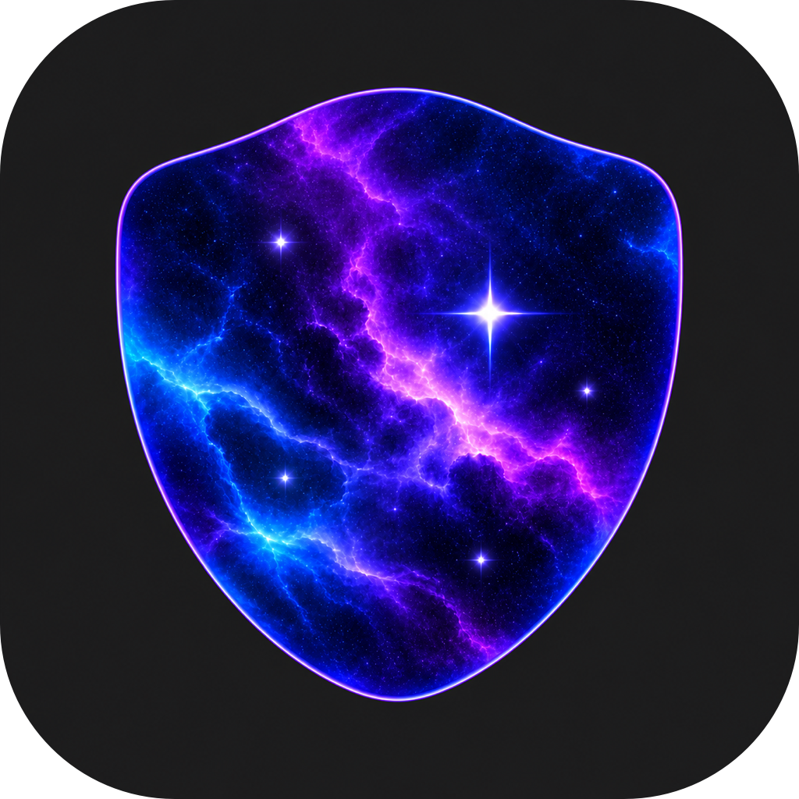

#  Memory Guard<br clear="right">

[English](README.md)

Memory Guard 守护你选定的 Mac 应用。当内存异常增长时，它可以暂停或结束造成增长的进程。

## 产品陈述

开发 Memory Guard 的起因是一次 Codex 任务。运行过程中，Codex 的内存占用突然飙升到数十 GB，最终导致整台 Mac 崩溃。我们希望在系统还有余力响应时，就能发现并制止这样的异常增长。

Memory Guard 持续观察 Codex 及其通过验证的内置辅助进程，同时看它们合计占了多少内存，以及哪个进程还在增长。总量越过阈值且确认增长异常时，它可以暂停造成增长的进程。达到紧急阈值时，它可以结束该进程，释放已经占用的内存。

你也可以把其他 Mac 应用加入保护名单。推荐阈值会根据本机的统一内存容量自动调整，每个应用都可以单独设置限值。

## Codex 的默认保护策略

首次启动时，Memory Guard 会自动添加识别到且签名通过验证的 Codex。推荐阈值按本机物理内存计算。下表以 64 GiB 的 Mac 为例。

| 触发条件 | 默认动作 |
| --- | --- |
| Codex 及其内置进程合计达到 32 GiB，且持续异常增长 | 暂停已验证的、造成增长的进程。 |
| 暂停后两分钟无人处理 | 强制结束该进程。 |
| 合计达到 40 GiB，且确认异常增长和对应进程 | 立即强制结束异常进程。 |

内存占用很高但保持稳定的进程，可以继续运行。强制结束可能丢失当前任务。你可以在**阈值**页修改两个数值，在**应用**页调整超时和紧急处理策略，也可以在**设置**中开启恢复已暂停进程的功能。

## 日常使用

- **选择要守护的应用。** 可以只监控、在异常时通知，或为通过验证的应用组件开启自动保护。发送进程信号前，守护程序会重新核对签名身份和进程启动时间。
- **看清内存变化。** 概览会同时展示最近五分钟的应用内存曲线、系统内存、压力和交换空间。打开可选的菜单栏图标，即可随时看到系统内存占用百分比。
- **减少后台负担。** 采样和暂停记录保存在内存中，日常监控无需定时写入采样文件。默认每两秒采样一次，事件默认保留三天。
- **关掉窗口，继续守护。** 关闭界面后，后台保护会继续运行。在设置里选择**完全退出**，或在应用菜单中选择**退出运行**，即可同时停止两个后台服务。登录时启动可按需开启。

## 隐私

Memory Guard 完全在你的 Mac 上运行，离线时也能正常守护。内存采样、增长判断和保护操作都在本机完成。应用无需账号，也不收集使用分析数据或追踪用户行为。

守护程序读取的是进程身份和内存计数，不读取对话、源代码或文档内容。近期采样保存在内存中。只有当你主动导出诊断时，应用才会将报告保存到你选择的位置，不会上传报告。

## 下载与安装

26.11.1 (6) · Apple Silicon · macOS 13 及以上。下载版采用本机签名，尚未公证，因此首次打开时可能需要你手动允许。

1. [直接下载 Memory Guard](https://github.com/sd800/memory-guard/releases/download/v26.11.1/MemoryGuard-26.11.1-6.zip)（ZIP，5.46 MB）。
2. 在访达中打开「下载」，双击 ZIP，解压得到 Memory Guard.app。如果浏览器已经自动解压，使用解压后的应用即可。
3. 将 Memory Guard.app 拖入访达侧边栏的「应用程序」。
4. 从「应用程序」打开 Memory Guard。如果 macOS 提示无法验证开发者或无法检查应用，点按「完成」或「好」关闭提示，保留应用。如果正常打开，直接继续第 7 步。
5. 打开「苹果菜单 → 系统设置 → 隐私与安全性」，向下滚动至「安全性」，找到 Memory Guard 对应的拦截提示，点按「仍要打开（Open Anyway）」。
6. 如系统要求，使用触控 ID 或 Mac 登录密码完成验证，再在确认对话框中点按「打开（Open）」。
7. 在 Memory Guard 的「阈值」页查看推荐值。如果需要接收保护提醒，在系统询问时允许通知。

如果没有看到「仍要打开」，先再次尝试打开已安装的应用，再返回「隐私与安全性」。更新已有安装前，请先在 Memory Guard 中选择「完全退出」，再替换应用。

## 构建与运行

在安装了 Xcode 和 macOS SDK 的 Mac 上执行以下命令。项目使用 Swift、AppKit 和 SwiftUI，无第三方包依赖。

```sh
git clone https://github.com/sd800/memory-guard.git
cd memory-guard
bash scripts/build.sh release
mkdir -p "$HOME/Applications"
ditto --norsrc --noextattr "build/Products.noindex/Memory Guard.app" "$HOME/Applications/Memory Guard.app"
open "$HOME/Applications/Memory Guard.app"
```

构建产物带有本机签名。更新已有安装时，请先完全退出，再替换应用。运行 `bash scripts/test.sh` 可验证检测和进程控制逻辑。

[官网](https://memory-guard.songming.org/zh/) · [构建与安装](docs/BUILD.md) · [检测机制](docs/ARCHITECTURE.md) · [实机验证](docs/VALIDATION.md) · [更新日志](CHANGELOG.md)

## 许可证

© 2026 Songming.org，采用 [MIT 许可证](LICENSE)。
